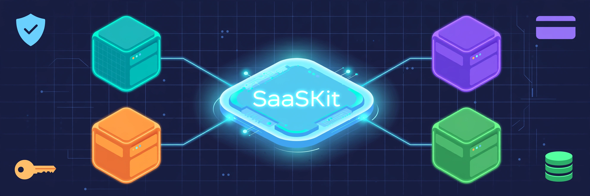
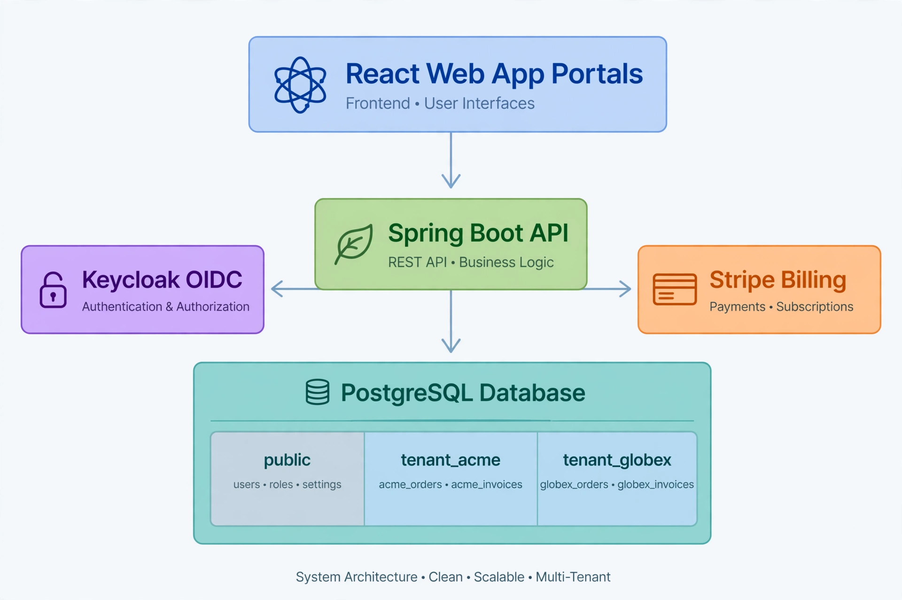

<div align="center">



# SaaSKit

### The multi-tenant SaaS starter kit that handles the hard parts

[](https://github.com/SachuJames/saaskit/actions/workflows/ci.yml)
[](LICENSE)


Most starter kits give you auth and a database and stop there. SaaSKit handles
the parts that actually hurt in production: tenant isolation, subscription
billing, audit trails, and GDPR tooling, from day one.

[Quickstart](#quickstart) • [Features](#features) • [Architecture](#architecture) • [API](#api-overview)

</div>

---

## Features

| | |
|---|---|
| 🔒 **True tenant isolation** | Schema-per-tenant Postgres. Each tenant gets its own schema, provisioned automatically with Flyway migrations. One bad query can never leak another tenant's data. |
| 🔑 **OAuth2/OIDC login** | Keycloak integration with realm roles mapped to Spring Security authorities. `@PreAuthorize("hasRole('ADMIN')")` just works. |
| 💳 **Stripe billing** | Checkout sessions, customer portal, and webhooks that keep each tenant's subscription status in sync. Plan-based feature gating included. |
| 📝 **Audit logging** | One `@Audited` annotation on any service method. Every action lands in the tenant's own audit trail. |
| 🛡️ **GDPR tools** | One-click data export and right-to-erasure for users. |
| 🖥️ **Two portals** | Admin portal (tenants, plans, subscriptions) and tenant portal (users, billing, audit log). |

## Architecture



The backend resolves the tenant per request, from the `X-Tenant-ID` header or
the `tenant_id` claim on the JWT, and points the JDBC connection at that
tenant's schema. Repositories never think about tenancy. The `public` schema
holds only the tenant registry.

```
Request → TenantFilter → TenantContext → TenantAwareDataSource → tenant_<slug> schema
```

## Tech stack

| Layer    | Choice                                                            |
| -------- | ----------------------------------------------------------------- |
| Backend  | Java 21, Spring Boot 3, Spring Security 6, Spring Data JPA, Flyway |
| Tenancy  | Schema-per-tenant, tenant-aware DataSource, per-schema migrations |
| Auth     | Keycloak (OIDC), JWT resource server                              |
| Billing  | Stripe (Checkout, webhooks, subscription mirroring)               |
| Database | PostgreSQL 16                                                     |
| Frontend | React 18, TypeScript, Vite, React Router                          |
| Infra    | Docker Compose (app, Postgres, Keycloak)                          |

## Quickstart

Prerequisites: Docker and Docker Compose.

```bash
git clone https://github.com/SachuJames/saaskit.git
cd saaskit
docker compose up --build
```

Then open:

- 🖥️ Frontend: http://localhost:3000
- 🔌 API: http://localhost:8080
- 🔑 Keycloak: http://localhost:8180 (admin/admin)

Demo users (seeded by the Keycloak realm import):

| Username | Password | Role  |
| -------- | -------- | ----- |
| `admin`  | `admin`  | admin |
| `demo`   | `demo`   | user  |

### Without Docker

You need Java 21, Node 20+, Postgres 16, and Keycloak 24+.

```bash
# backend
cd backend
mvn spring-boot:run

# frontend
cd frontend
npm install
npm run dev
```

Copy `.env.example` to `.env` and fill in your Keycloak and Stripe values.
See [Configuration](#configuration).

## Configuration

All settings come from the environment. Nothing secret is hardcoded.

| Variable                      | Default                                | Purpose                                 |
| ----------------------------- | -------------------------------------- | --------------------------------------- |
| `SPRING_DATASOURCE_URL`       | `jdbc:postgresql://localhost:5432/saaskit` | Postgres connection                 |
| `SPRING_DATASOURCE_USERNAME`  | `saaskit`                              | DB user                                 |
| `SPRING_DATASOURCE_PASSWORD`  | `saaskit`                              | DB password                             |
| `KEYCLOAK_ISSUER`             | `http://localhost:8180/realms/saaskit` | Keycloak realm (JWT issuer)             |
| `STRIPE_API_KEY`              | _(empty)_                              | Stripe secret key (billing off if empty)|
| `STRIPE_WEBHOOK_SECRET`       | _(empty)_                              | Stripe webhook signing secret           |
| `STRIPE_PRICE_PRO`            | _(empty)_                              | Stripe price ID for the PRO plan        |
| `STRIPE_PRICE_ENTERPRISE`     | _(empty)_                              | Stripe price ID for the ENTERPRISE plan |

## Project structure

```
saaskit/
├── backend/                      # Spring Boot 3 application
│   └── src/main/java/com/saaskit/
│       ├── tenancy/              # TenantContext, filter, provisioning
│       ├── security/             # Keycloak role mapping
│       ├── billing/              # Stripe checkout, webhooks, subscriptions
│       ├── audit/                # @Audited aspect + audit log
│       ├── gdpr/                 # Data export + erasure
│       ├── admin/                # Tenant management API
│       └── user/                 # Tenant user management
├── frontend/                     # React portals (admin + tenant)
│   └── src/
│       ├── admin/                # Tenant management UI
│       └── tenant/               # Billing + audit UI
├── keycloak/
│   └── realm.json                # Realm export with demo users
├── docker-compose.yml
├── demo.sh
└── .github/workflows/ci.yml
```

## API overview

All tenant APIs accept the `X-Tenant-ID` header, or a JWT carrying the
`tenant_id` claim.

```
POST /api/admin/tenants              # provision a tenant (ADMIN only)
GET  /api/admin/tenants              # list tenants (ADMIN only)

GET  /api/users                     # list tenant users
POST /api/users                     # invite a user

GET  /api/billing/subscription      # current subscription
POST /api/billing/checkout          # Stripe checkout URL for a plan

GET  /api/audit                     # tenant audit trail

GET  /api/gdpr/export               # download my data (JSON)
DELETE /api/gdpr/erasure            # erase my data

POST /api/public/stripe/webhook     # Stripe events (signature verified)
```

## Testing

```bash
cd backend
mvn test        # 14 tests: tenancy, auth, stripe webhooks

cd frontend
npx tsc --noEmit  # type check
```

The backend suite covers tenant context isolation, schema name generation,
Keycloak role mapping, and Stripe webhook signature verification.

## Roadmap

- Row-level tenancy as a second supported strategy
- Usage-based billing (Stripe metered plans)
- Per-tenant feature flags
- SCIM provisioning for enterprise tenants

## License

MIT. See [LICENSE](LICENSE).
